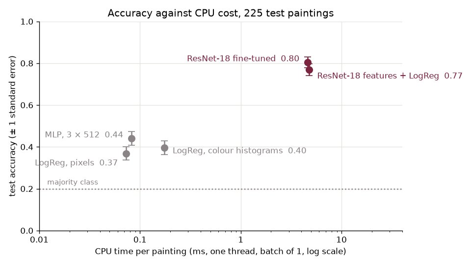

# Final project: an intelligent museum guide

We are the AI team of a (fictional) mid-sized French fine-arts museum. The Museum wants a guide, on visitors' phones and on gallery kiosks, that:

1. **Recognises what the visitor is looking at**: from a photo of a painting, predict its style (Impressionism, Baroque, Cubism…) or its genre (portrait, landscape, still life…).
2. **Answers questions in natural language**: "Which painting shows a stormy sea?" returns the best-matching artworks of the collection.

The director also wants a clear recommendation: the kiosks run on modest CPUs, the team is small and the budget is limited. **Is a neural network worth it in production, or would a simpler classical model do the job?**

Full brief: [`consign.md`](consign.md). Deadline: **30 October 2026** (Git repository + 10 min presentation + 5 min Q&A).

## Deliverables

- [x] A feed-forward network in PyTorch for artwork classification: [`notebooks/mlp.ipynb`](notebooks/mlp.ipynb)
- [x] Training monitoring and failure diagnosis: [`notebooks/monitoring.ipynb`](notebooks/monitoring.ipynb), [`notebooks/diagnosis.ipynb`](notebooks/diagnosis.ipynb)
- [x] A pretrained CNN (ResNet) for image classification: [`notebooks/resnet.ipynb`](notebooks/resnet.ipynb)
- [x] A recommendation to the director, backed by measurements (accuracy, CPU latency, model size): [below](#recommendation-to-the-director), [`notebooks/recommendation.ipynb`](notebooks/recommendation.ipynb)
- [ ] The 10-minute presentation: [`presentation/`](presentation/)

Work is tracked in the GitHub issues and milestones.

## Layout

```
Final Project/
├── consign.md               project brief
├── make_wikiart_subset.py   builds the WikiArt subset (provided)
├── requirements.txt
├── src/                     shared code
│   ├── data.py              WikiArt subset, shared split, DataLoaders, flip augmentation
│   ├── train.py             training loop, early stopping, metrics, json saving
│   ├── models.py            MLP and pretrained ResNet-18
│   └── plots.py             learning curves and run comparisons
├── notebooks/               experiments, to run in order (see below)
├── results/                 metrics (json/csv) and figures; model weights (*.pt) are git-ignored
├── presentation/            slides for the oral defence
└── data/                    WikiArt subset, local only (git-ignored)
```

## Data

The data comes from the `huggan/wikiart` dataset on the Hugging Face Hub, through `make_wikiart_subset.py`. **WikiArt images must not be committed**: we commit the script, the exact command and `subset_info.json`. The only paintings in the repository are the 12 small thumbnails of `results/diagnosis_errors.png` (also in the output of the `diagnosis` notebook and on slide 9), which show the most confident errors of the ResNet. The repository is private, shared with the team and the teachers.

We classify paintings by **style**, with five visually contrasted movements: **Impressionism, Baroque, Cubism, Ukiyo-e and Pop Art**, 300 images each, 128 × 128 px. Style is what the guide needs to tell the story of a movement. These five differ in palette, brushwork and composition, so the task can be learnt from 1 500 images, and there is still room for a gap between a classical model and a CNN.

Build it from `Final Project/` (about 4.2 GB streamed, up to about 1h30 on a home connection, re-running resumes):

```bash
pip install -r requirements.txt
python make_wikiart_subset.py --label style \
    --classes Impressionism Baroque Cubism Ukiyo_e Pop_Art \
    --per-class 300 --size 128 --out data/wikiart_style5
```

The seed and the dataset revision are pinned, so everybody gets the same images. Check that your `data/wikiart_style5/subset_info.json` has the same `counts` and `shards` as the committed one.

Class indices follow the alphabetical folder order of `ImageFolder`, not the order of the command: Baroque 0, Cubism 1, Impressionism 2, Pop_Art 3, Ukiyo_e 4 (the `classes` list in `subset_info.json`).

## Reproduce the results

Set up the environment of the [root README](../README.md), then `pip install -r requirements.txt` here and build the data (above). Run the notebooks **in this order**, because each one reads what the previous ones saved in `results/`:

| # | Notebook | What it does | Writes to `results/` | Time |
| --- | --- | --- | --- | --- |
| 1 | [`baseline`](notebooks/baseline.ipynb) | majority class, logistic regressions on pixels and on colour histograms | `baseline.json`, `baseline_confusion.png` | 15 s |
| 2 | [`mlp`](notebooks/mlp.ipynb) | feed-forward network: architecture, activation, regularisation | `mlp.json`, `mlp_*.png`, `mlp.pt` | 35 s |
| 3 | [`resnet`](notebooks/resnet.ipynb) | pretrained ResNet-18: head only, fine-tuning, features + logistic regression | `resnet.json`, `resnet_*.png`, `resnet.pt` | 1.5 min on GPU |
| 4 | [`monitoring`](notebooks/monitoring.ipynb) | learning rate, gradient norm per layer, activations | `monitoring.json`, `monitoring_*.png` | 10 s |
| 5 | [`diagnosis`](notebooks/diagnosis.ipynb) | each failure: symptom, diagnosis, fix, measured effect | `diagnosis.csv`, `diagnosis_*.png` | 20 s |
| 6 | [`benchmark`](notebooks/benchmark.ipynb) | CPU time per painting on one thread, parameters, model size | `benchmark.csv`, `benchmark.png` | 20 s |
| 7 | [`recommendation`](notebooks/recommendation.ipynb) | accuracy against CPU cost: the table and the figure of the recommendation | `recommendation.png` | 5 s |

Times measured on an Apple M4 Pro laptop. In Jupyter, use *Restart & Run All*; from the command line:

```bash
cd notebooks
jupyter nbconvert --to notebook --execute --inplace --ExecutePreprocessor.timeout=-1 baseline.ipynb
```

- `resnet` trains on the first device available: a CUDA GPU, the Apple GPU (MPS), else the CPU, where one epoch is about 8 times slower. Its first run downloads the ImageNet weights of ResNet-18 (45 MB) into the PyTorch cache. The other notebooks run on the CPU.
- The weights `mlp.pt` and `resnet.pt` are git-ignored. `diagnosis` loads `resnet.pt`, so run `resnet` first.
- `benchmark` runs the trained models on the real test paintings, so it needs the data and `mlp.pt` and `resnet.pt`: run `mlp` and `resnet` first. It refits the logistic regressions with the settings saved in `results/`, and checks that classifying one painting at a time gives the accuracies of the other notebooks.
- `recommendation` only reads `results/`: it needs neither the data nor the weights.
- Every notebook fixes its seeds: running one twice on the same machine gives the same numbers (checked for each of them). On another machine, the two networks can move by about one point. From a fresh clone on an Apple M4 Pro, the MLP gives 0.431 and the fine-tuned ResNet 0.796, against 0.440 and 0.804 in `results/` (Apple M5 Pro). The logistic regressions, including the one on the ResNet features, give exactly the same numbers. One point is well within the ± 3 points of the test set, and no conclusion changes.

## Results

Test set: 225 paintings, 45 per style, the same for every model.

| Model | Accuracy | Macro-F1 | Source |
| --- | --- | --- | --- |
| Majority class | 0.200 | 0.067 | `results/baseline.json` |
| Logistic regression, raw pixels (16 px) | 0.369 | 0.339 | `results/baseline.json` |
| Logistic regression, colour histograms | 0.396 | 0.380 | `results/baseline.json` |
| MLP, 3 × 512, dropout and flips | 0.440 | 0.432 | `results/mlp.json` |
| Logistic regression on ResNet-18 features | 0.769 | 0.769 | `results/resnet.json` |
| ResNet-18 fine-tuned | 0.804 | 0.802 | `results/resnet.json` |

With 225 test paintings, the standard error of an accuracy is about 3 points. The failures met on the way, and how each fix was measured, are summarised in `results/diagnosis.csv`.

## Recommendation to the director

**A neural network is worth it, for its pretrained features. We recommend the features of a ResNet-18 pretrained on ImageNet, kept frozen, with a logistic regression on top, and a guide that answers only when it is confident enough.**

Source: [`notebooks/recommendation.ipynb`](notebooks/recommendation.ipynb), which gathers `results/benchmark.csv`, `baseline.json`, `mlp.json` and `resnet.json`. CPU time: median over the 225 test paintings, one thread, one painting at a time, on an Apple M5 Pro.

| Model | Accuracy | Macro-F1 | CPU time per painting | Saved model | Training | What an update of the collection needs |
| --- | --- | --- | --- | --- | --- | --- |
| Logistic regression, raw pixels | 0.369 | 0.339 | 0.07 ms | 16 kB | 0.01 s, CPU | refit on a CPU in under a second |
| Logistic regression, colour histograms | 0.396 | 0.380 | 0.18 ms | 2 kB | 0.2 s, CPU | refit on a CPU in under a second |
| MLP, 3 × 512 | 0.440 | 0.432 | 0.08 ms | 8.4 MB | 1.5 s, CPU | retrain on a CPU in a few seconds, check the early stopping |
| **ResNet-18 features + logistic regression** | **0.769** | **0.769** | **4.8 ms** | **45 MB** | 0.3 s, laptop GPU | extract the features of the new paintings (5 s for 1 050 on one CPU core), refit the logistic regression |
| ResNet-18 fine-tuned | 0.804 | 0.802 | 4.6 ms | 45 MB | 15 s, laptop GPU | retrain 11 million weights on a GPU, check the early stopping, send a new 45 MB model to every kiosk |



**Why**

1. **Accuracy decides between a network and a classical model.** Every model that only sees pixels or colours, the MLP included, is wrong more than half the time (0.37 to 0.44). A guide that tells the story of the wrong movement once in two is not a product. The pretrained ResNet-18 features reach 0.77 to 0.80, far beyond the ± 3 points of the test set.
2. **The CPU cost does not rule the ResNet out.** 4.8 ms per painting on one core is about 200 paintings per second; on a CPU 20 times slower it would still take under 0.1 s. The 45 MB model is loaded once, when the kiosk starts.
3. **Maintenance decides between the two ResNet options.** They cost the same on the kiosk. Fine-tuning is a few points more accurate: +3.5 on the test set, about one standard error, and +5.6 on validation. But each change of the collection then means a GPU run that overfits after 3 epochs and must be watched, and a new 45 MB model on every kiosk. With frozen features, the backbone is the standard ImageNet ResNet-18 and never changes: only a logistic regression of 2 565 weights is refitted, in seconds on a CPU. For a small team with a limited budget, it is the option with the least to maintain.
4. **Answer only when confident.** The ResNet is less confident when it is wrong (0.72 against 0.87). With a threshold of 0.7, the fine-tuned network answers 78 % of the test paintings and is right on 87 % of them; for the others the guide says it is not sure (`results/diagnosis.csv`). This was measured on the fine-tuned network: the threshold of the deployed model must be set on the validation set.

**When the answer would change**

- If a few points of accuracy matter more than the cost of the updates, and a GPU is available each time the collection changes: fine-tune the whole network. The cost on the kiosk stays the same.
- Before deploying, run `benchmark` once on the kiosk itself. Only the absolute times should change, not the ranking.

**Limits**

- **Data size.** 1 500 paintings, 5 visually contrasted styles, 45 test paintings per style: an accuracy is known to about ± 3 points. A real collection has more styles, and closer ones (Impressionism and Post-Impressionism): expect a lower accuracy.
- **New styles.** Adding a style means labelling paintings of it. We trained with 210 paintings per style and did not measure how few would be enough.
- **Photos taken in the gallery.** Not tested. WikiArt images are clean scans; a visitor's photo has reflections, angles, frames and another lighting. A test set of real photos is needed before any launch, and probably a training with random crops, colour changes and perspective.
- **Atypical works.** Drawings, sketches and engravings are among the most confident errors (`results/diagnosis_errors.png`).
- **Image size.** We trained at 128 pixels. 224 pixels, the ImageNet resolution, might add a few points for 2.1 times the CPU time (9.7 ms per painting).
- **Out of scope.** The genre of a painting and the natural-language search of the brief were not built (issue #13).
